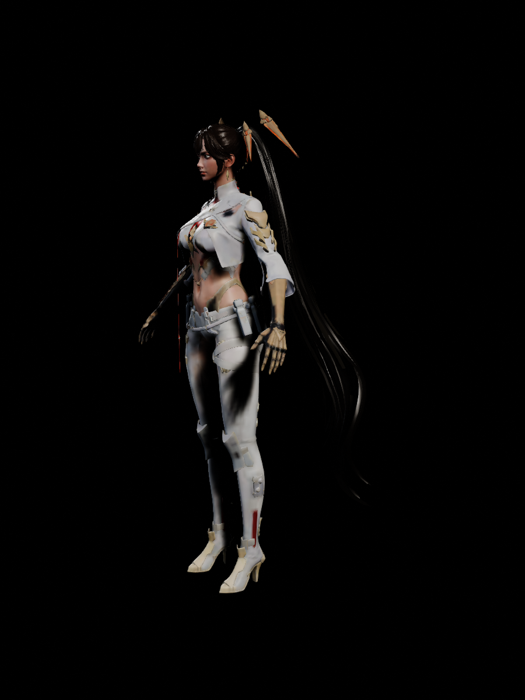

# PC 资源的 UE5.8.4 转换

转换时使用的完整 PC 导出入口是 `PCResources`，主要输出是 `Content/PCAssets` 下的可编辑 UE 资产。原始导出已保存在 [已发布快照](https://github.com/AliYa-chen/NZMCharacterViewer/tree/03152adb7ce937649f890455d6650f346e82acc1/PCResources)，普通运行只读取 `Content`。角色集合入口为 `/Game/PCAssets/Collections/DA_PCAssetLibrary`；各角色资源根另有独立集合，集合中的软引用可定位到网格、贴图和材质。

原生资产库独立保存；运行 Catalog 另外按真实 `UIConfig` 接入 12 名角色、17 套高清组合，并保留九套旧版对照。高清组合默认在前，沿用已有头像。待机适配、眼部修正、动态兼容和 PC 环境见 [高清角色接入](PC_VIEWER_INTEGRATION.md)，这些新增运行资产不改变下列原生库的验收索引。

| 输出 | 计划数量 | 转换范围 |
| --- | ---: | --- |
| SkeletalMesh | 309 | 已导出的最高可用 LOD、原点坐标、法线、所有 UV、顶点色、材质槽和最多 8 条权重 |
| Skeleton | 309 | 每个网格独立骨架；不把未经核对的同名骨架合并 |
| Texture2D／TextureCube | 1081 | 按图像与来源设置去重，保留 sRGB、压缩、寻址等；HDR 为已发布的重投影全景 |
| Material／MaterialInstanceConstant | 629 | 保留父级、明确的混合／双面覆盖和可识别参数，生成 stock UE 材质候选 |
| PCSourceRecord | 4472 | 配置、材质节点、衣物、动画引用、粒子及其他 JSON／说明文档的来源归档 |

309 个网格输出覆盖全库唯一几何及保留的历史快照；角色源包可按实际字节与绑定复用几何，输出数量不是不同服装数。

另外生成 14 个角色资源集合、总资源库、4 张材质默认支撑纹理，以及 `/Game/Viewer/PCEnvironment` 下 14 个桌面／移动环境候选。实际文件、字节数、SHA256 和来源映射见 [资产索引](PCAssetConversion/asset_index.json)；验证状态和缺口见 [转换摘要](PCAssetConversion/conversion_summary.json)。

2026-11-10，本机已完成全部 6,833 个资产的文件／结构审计，以及 629／629 个材质的真实 Metal SM6 shader 检查。Mac Editor 与 iOS arm64 Development 编译／链接通过；iOS 检查不含 cook、签名、安装或真机运行。全项目依赖检查无缺失或未知项；28 个此前已有的未使用材质保留，新增资源库与环境候选均可从声明入口到达。

转换验收后已清理 `Saved` 中的重复提取、测试输出、旧模型备份和工具缓存，以及项目／导入插件的 `Intermediate` 与项目 DDC，释放约 11 GiB。`Saved` 只保留编辑器个人设置，已生成资产与编译结果保留；清理后全部 6,833 个资产的字节数和 SHA256 再次与索引一致。详情见 [清理记录](PCAssetConversion/cleanup_report.json)。

最终验收所需的 23 份计划、报告、shader／预览和编译证据已按原路径压缩保存在 [证据归档](PCAssetConversion/conversion_evidence.tar.gz)，约 5.6 MiB；文件清单和哈希见 [归档清单](PCAssetConversion/evidence_manifest.json)。报告中的 `Saved/...` 指向当时验证路径。正常打开和使用 UE 资产不需要还原这些报告；需要重跑完整审计时，在仓库根目录恢复证据后执行：

```bash
tar -xzf Docs/PCAssetConversion/conversion_evidence.tar.gz -C .
python3 Scripts/validate_pc_asset_conversion.py --require-render-validation
```

以上命令对应原生转换验收快照。接入查看器后，新运行包使用独立报告批准；完整来源结构复查应先恢复原始导出和该证据，再运行 `python3 Scripts/validate_pc_asset_conversion.py --allow-viewer-integration`。此模式核验原 6,833 个包和报告批准的新增包，只写独立的 `Saved/PCViewerIntegration/source_conversion_recheck.json`，不改原索引。`--require-render-validation` 仍要求当前工具与 shader 执行证据一致；不能把旧版编译指纹当作新工具的复查通过。

以下是新转换 Lucia 完整 Preview 网格的实际离屏渲染，使用参考姿势和简单预览灯光。它只证明该模型与候选材质可以实际渲染，不是原游戏画面对照。



## 转换与验证规则

`Plugins/PCAssetImporter` 直接读取 ActorX，生成 UE 的 SkeletalMesh 与 MeshDescription，不经过四权重 glTF 或不透明的 FBX 中转。导入器反向执行固定版导出器的 Y 镜像、四元数和面绕序变换，并读取 32 位面索引、额外 UV 和顶点色。导入时将角索引规范为三角形角的顺序，使用 UE 公开的 MeshDescription MikkTSpace 接口生成切线，并关闭渲染构建中的重复切线计算；原点索引、几何、UV、法线、颜色和权重保持。切线的构建比较阈值使用来源设置中的 `2e-5`，位置和 UV 比较仍为精确值。

网格材质按 `LOD0.Sections → 原 MaterialIndex → ActorX MATT` 映射。不能直接把原 `SkeletalMaterials` 数组按序贴到导出槽上；原本为空的槽继续为空。源文件、历史版本及同几何的不同绑定均在计划中分别记录。

重新启动 UE 后，验证保存的源几何、三角形与材质索引、UV、法线、顶点色、骨骼绑定以及构建后的每条非零权重。UE 使用 16 位权重量化，允许的绝对误差明确记录为 `4/65535`；不能把量化后数据称为原始浮点字节无损。ActorX 未保存原始骨骼 scale 和 tangent；上游已将父级 scale 烘入平移，tangent 在 UE 中重算。没有重新生成未导出的 LOD 或 morph。

构建后的法线还会与归一化来源法线比较，并检查切线帧的有限性、长度和正交性。只连接到退化 UV／几何或 UE 安全法线归一化下近退化三角形的顶点，其切线例外单独计数；不删掉来源三角形，也不把这些例外称为正常切线帧通过。

本次切线与构建去重修正使全库构建顶点数从早期导入的约 1,557 万降到约 433 万。来源点、面与全部非零权重保持；这是资源构建统计，不是帧率或真机性能测试。

纹理按“图像字节＋设置”区分，避免同字节但不同 sRGB／压缩设置被错误共用。原游戏分支中 stock UE 不支持的过滤和纹理组枚举使用显式候选替代，原值与替代依据保留在导入报告中。PNG／HDR 导入不是原游戏压缩块的字节恢复。

## 材质、动画和特效的边界

材质候选使用原明确的基础色、法线、自发光、标量和透明／双面设置。线性、sRGB 和 Masks 采样分别处理。未证明的 RAM／PSAR／ORM 通道不会凭文件名连接到 roughness、metallic 或 AO。AIRR R 透明度沿用已有查看器的视觉证据近似，并在报告中标注；缺少可用透明度来源的材质保留为待恢复项。

源私有 Hair、Eye、SSS、PRT、材质层和动画特效方程没有因生成 `.uasset` 而自动恢复。部分根材质额外默认参数引用了未发布的 12 个纹理包，相关 173 条引用保留为缺失，不计为成功转换。

`PCSourceRecord` 是可编辑的来源记录，设置为 editor-only。衣物参数、动画引用、粒子 JSON 和材质表达式记录不等于已可播放的动画、Chaos Cloth、Niagara 或完整可执行 shader 图。新增角色尚缺完整原始动画源，不能把静态骨架导入通过解释为原动作与面部动画通过。运行接入另外验证了 67 份已有待机的骨架适配，新角色使用明确标注的共享待机；这不会补齐缺失的原动作。

环境候选按模板继承和组件链解析灯光，保留显式 false、sRGB 灯色转换及后期 override 的区别。缺省和 stock 兼容值单独记录；原十四个候选保持独立，运行接入另建十二个环境资产并启用 PC 来源模式。已恢复字段与路由缺口见高清接入报告；后续私有 shader／粒子重建和原游戏画面对照仍按 [渲染交接](PC_CHARACTER_RENDERING_HANDOFF.md) 执行。

## 重复执行

先安装 UE5.8.4。需要重新转换来源文件时，先恢复已发布原始导出，再执行下列源验证；普通运行不需要这一步：

```bash
git restore --source=03152adb7ce937649f890455d6650f346e82acc1 -- PCResources
python3 Scripts/validate_pc_resources.py
python3 Scripts/build_pc_asset_plan.py
Scripts/build_macos.sh
python3 Scripts/run_pc_asset_conversion.py --stage all
```

计划位于本机 `Saved/PCAssetConversion/asset_plan.json`。批次使用独立 Editor 进程控制内存；状态同时检查逐项计划摘要、导入器版本、源哈希和资产哈希。报告在 `Saved/PCAssetConversion`，失败批次停止，重新执行可复用已核验结果。只写新建的独立目录，不用原全量导入器重建 Catalog。

纹理、材质、网格和绑定完成后，用 UE Python 分别执行 `Scripts/import_pc_environment_candidates.py` 与 `Scripts/import_pc_asset_collections.py`，再运行：

```bash
python3 Scripts/validate_pc_asset_conversion.py --allow-viewer-integration
```

最终文件审计要求全部计划目标已落盘且通过新进程校验；未完成阶段会返回非零。使用上述兼容选项前需已有完整高清接入报告，否则保持默认严格模式。`-nullrhi` 的数据导入与结构校验不构成 shader、画面、动画或设备性能验收；实际运行、画面与目标设备分别记录。

真实 Metal shader 检查可独立重复执行，已有报告只有在计划、范围和当前资产哈希仍匹配时才复用：

```bash
python3 Scripts/run_pc_asset_shader_checks.py
```

`Scripts/preview_pc_asset.py` 在真实渲染命令行中配合 `-AllowCommandletRendering` 执行，可通过 `-PCPreviewMesh` 指定计划中的源包或目标。该工具只创建瞬态场景，PNG 和报告写入 `Saved/PCAssetConversion/Preview`，不保存或替换项目地图。
